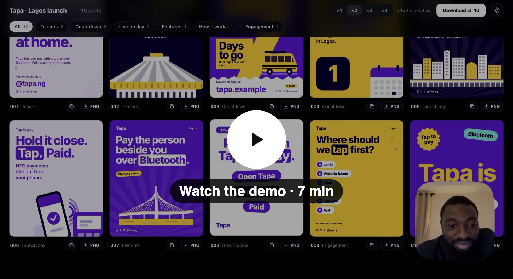

# Social Post Designer

A Claude Code skill that designs a brand's social media posts, end to end. Give it a one-line brief ("posts for
our savings app's launch in Nairobi"), or your brand guide, colours, fonts and photos, and it plans the campaign,
writes the copy, finds the photos and builds a gallery of finished posts you can download as PNG.

Created by **Yahaya Muhammad**.

## Watch the demo

[](https://github.com/kmcdotninja/social-post-designer/releases/download/demo/social-post-designer-demo.mp4)

Seven minutes, from installing the skill to a gallery of finished launch posts.
[Download the video (73 MB)](https://github.com/kmcdotninja/social-post-designer/releases/download/demo/social-post-designer-demo.mp4)

## Why it exists

I was working on my own projects and kept designing post after post by hand: launch countdowns, service posts,
neighbourhood posts, tips, polls, release notes. After a few hundred of them, I felt there should be something that
lets anyone create social media posts like these, for any brand, without starting from a blank canvas.

So I turned what those projects taught me into a skill. It holds two complete post systems I designed and refined
with real feedback (a 146-post city launch and a 100+ post set for a children's app): their layouts, typography,
alignment, the rules every correction taught me, and a small engine that applies them to any brand's fonts and
colours.

## What it does

- **Thinks before it designs.** It works out the brand, the audience, the moment (launch, countdown, feature drop,
  promo, event, an always-on month) and the action you want, then plans series of posts for your industry: fintech,
  food, home services, health, education, retail, SaaS, real estate, events and more.
- **Uses what you bring first.** Your photos, brand guide, colours, fonts, design-system tokens and past posts
  override its defaults. It fills only the gaps.
- **About 100 layouts** in three families: general layouts; a poster system (pictures that peek in or run off the
  edge, Swiss-style type, sticker walls, shape bands, release posts, second-script posts); and a launch system
  (countdowns, boarding passes, passport stamps, departure boards, neighbourhood posts, photo cards, polaroids,
  polls and quizzes).
- **Image-led posts.** It finds free-licence photos (Unsplash or Pexels with a free key, otherwise Openverse) and
  credits them in captions when the licence asks for it.
- **Any font, any palette.** Colour pairs are chosen by measured contrast, so text always reads. Headlines shrink to
  fit their box. A collision check makes sure nothing ever touches anything else.
- **A gallery** to browse, filter, view large, copy captions, and download PNGs at ×1–×4 or all at once.
- Also: flat brand illustrations (with hands traced from a reference, not drawn freehand), print pieces, logo packs
  and social covers.

## Install

```sh
git clone https://github.com/kmcdotninja/social-post-designer ~/.claude/skills/social-post-designer
```

Needs [Claude Code](https://claude.com/claude-code), Node 20+ and Google Chrome. Python 3 with Pillow, numpy, scipy
and `potrace` only if you want to trace illustrations from a reference.

## Use

In Claude Code, just ask:

> Design 30 Instagram posts for the launch of our savings app, Kudi, in Lagos. Our colours are deep green and lime.

> Here's our brand guide (guide.pdf) and our photos (~/Pictures/shoot). Make a month of posts.

Claude plans the set, shows you the plan, then builds it. You can also drive the engine yourself:

```sh
node ~/.claude/skills/social-post-designer/scripts/new-project.mjs my-posts brand.json
cd my-posts && npm install
npm run brand     # check the colours' contrast
npm run photos -- "lagos street market" "friends saving phone" --n 3
npm run dev       # the gallery
npm run check     # nothing touches anything
npm run render    # PNGs in out/
```

Edit `brand.json` (name, contacts, font, colours, style) and `src/posts.js` (the posts). The layouts and their fields
are listed in `references/layouts-*.md`.

## What's inside

| | |
|---|---|
| `SKILL.md` | how Claude uses the skill: the workflow and the design rules |
| `references/` | planning campaigns by industry, brand intake, typography and layout, the layout catalogues, illustration, production |
| `starter/` | the engine a new project is made from |
| `scripts/` | `new-project.mjs` to start a project, `trace_reference.py` to trace illustrations |
| `templates/` | a print exporter (PDF, SVG and PNG per side) |

## Licence

MIT, free to use, change and share. See [LICENSE](LICENSE).
